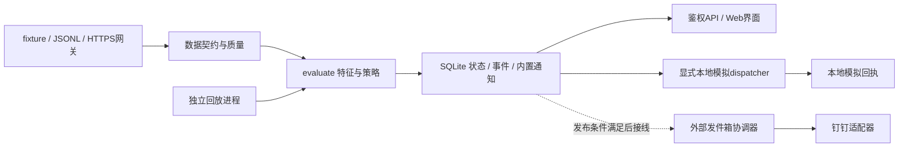

# 项目架构、目录结构和数据组织

## 技术栈与边界

模块化单体＋独立后台进程。Python3.9+标准库承担策略、HTTP服务、SQLite和通知；前端为原生ES modules/HTML/CSS，无npm构建依赖。React、Parquet、DuckDB是原规格中的备选建议，当前运行时未引入。



worker可用完整模拟计划显式启用本地投递线程，或独立CLI消费已有模拟队列；真实机会渠道仍未接线，只有用户显式触发的钉钉测试使用真实渠道代码。LLM和券商均不在运行链路。

## 代码目录

```text
stockradar/
├── __init__.py          # 软件版本
├── __main__.py          # CLI、研究/运行入口、备份恢复
├── config.py           # 完整配置、类型与未知键校验、哈希
├── fixture.json        # 包内默认配置/校验模板
├── fixture-v1.json     # 原配置格式模板；保留旧版本哈希与范围
├── fixtures.py         # 合成场景
├── providers.py        # 批次验证、JSONL、标准HTTPS网关
├── vendor_samples.py   # 独立原始采集/单位诊断/日线比较；不送入evaluate
├── public_sources.py   # 固定匿名HTTPS请求、JSON/字面量JSONP及原始字段映射
├── fuyao_source.py      # Fuyao公开日线/当前关系请求与原始响应校验
├── connection_settings.py # 独立连接元数据/私有令牌文件、修订与单次测试
├── minute_quality.py   # 离线原始分钟诊断/显式口径对齐；不生成标准batch
├── minute_grid.py      # schema2显式阶段、证券状态与无成交网格
├── minute_acceptance.py # 四阶段预算/日期准备，输出未授权计划；不读凭据或发网
├── minute_feed.py      # Tushare分钟手动获取、独立原始存储及只读页面投影
├── source_health.py    # 本机采样清单、接口计数、匹配的分钟诊断
├── acceptance.py       # 显式数据样本/钉钉连接PoC，不授权发布
├── evidence.py         # 触发/最新图表与热点阶段时间线
├── temporal.py         # 传输与策略共用的日期/UTC有效区间解析
├── engine.py           # 确定性特征、策略、标签与状态
├── store.py            # SQLite事务、快照、事件、水位与反馈
├── notifier.py         # 钉钉签名、消息与结果分类
├── outbox.py           # 独立投递协调器、窗口聚合、复查、重试与请求限流
├── dispatcher.py       # 仅本地模拟的独占生命周期、时钟、调度和报告
├── replay.py           # 同一策略的功能回放与价格观测
├── contracts.py        # 研究/运行严格字段、UTC与独占报告写出
├── execution.py        # 保守独立信号成交/成本、公司行为与指标
├── research.py         # 四组显式计划、时间隔离、聚类与哈希
├── study_fixture.py    # 明确模拟的多日研究样例/完整计划
├── study_jobs.py       # 成本研究任务、配置分组、代表案例与完整导出
├── operations.py       # worker互斥/心跳/运行事实与证据门槛
├── worker.py           # 扫描循环、长退避心跳与有界子进程守护
├── maintenance.py      # 原始输入只读压缩归档与校验
├── benchmark.py        # 有界合成负载、并发回放与资源计量
├── zsxq_events.py      # 指定知识星球有界手动采集、文本脱敏与不可覆盖快照
├── zsxq_store.py       # 独立知识星球事件库：跨次去重、修订、覆盖水位/缺口与每日预算
├── service.py          # 应用用例、任务进程、诊断
├── server.py           # 本地HTTP API和静态文件白名单
└── static/
    ├── index.html
    ├── app.js          # Hash路由、渲染、API与交互
    ├── evidence-chart.js # K线坐标、冻结位及可核对来源表
    ├── study-view.js   # 四组研究的分段/成本/分母展示
    ├── connection-view.js # 行情/模型独立表单；不回填或持久化浏览器Key
    ├── minute-view.js  # 最新/当日/历史分钟请求、原始图表和未知状态
    ├── real-market-view.js # Fuyao报价/日线独立查看与显式手动刷新
    ├── setup-view.js   # 首次设置与常用策略配置引导页
    ├── history-view.js # 数据源健康、热点阶段时间线、策略卡和研究案例
    └── styles.css
configs/fixture.json    # 显式--config样例，与包内配置同步
configs/fixture-v1.json # 原配置完整保留，与包内历史模板同步
configs/operations-fixture.json  # 完整合成运行验收计划，源码样例
configs/operations-fixture-v1.json # 历史12证券运行计划
configs/dispatcher-fixture.json   # 完整本地模拟投递计划，独立于策略配置
tests/                  # 策略、应用、研究、运行、负载及通知测试
data/                   # 本地生成物，不纳入源码
research/               # 原资料、上游证据、历史提案
```

文档文件分工见[README中的文档树](../README.md)，主开发约定见[AGENTS](../AGENTS.md)。

## 入口与模块职责

`zsxq_events` 提供独立手动命令，调用本机已授权的官方知识星球 CLI，限定群和一页 1—20 条主题。文本/附件 ID 白名单投影、UTC 观察时间、稳定内容哈希及不可覆盖快照保存于显式输出目录。`zsxq_store` 提供与策略库完全分离的 SQLite 事件库，负责快照校验导入、带每日预算预先记账的手动单页读取、跨次主题去重与修订版本记录、倒序分页连续覆盖水位及未重叠开放缺口（`gaps`）追踪；两者均不连接 Application、Store、evaluate 或通知器。外部 CLI 与私有采集记录不随应用打包；自动事件分析及页面尚未接线。[使用与真实读取证据](development/zsxq-events.md)

`Application`连接provider/策略/store与API。`evaluate(batch, config, prior_state)`只做确定性评估，不调用外部网络或LLM；配置校验当前会读取包内模板。它返回state、market、sectors、signals、events、evaluations、tags和quality。

`connection_settings`与策略配置/SQLite分离，管理数据库旁`.connections`元数据和只写令牌文件。鉴权API读取脱敏状态，显式POST保存或单次测试；环境变量优先，测试绑定参数和凭据修订，仅在当前进程留存。模型测试只访问目录，没有推理或evaluate接线。`vendor-sample --connections-dir`可读取同一目录的行情Key，仍由独立计划控制访问依据和请求预算。

配置schema2新增显式STAR参数与fixture-v2-star默认版本；无schema字段的历史v1继续按原模板校验，不补字段。provider及evaluate校验交易所/板块组合，合格STAR参与股票池、板块可比集合与覆盖分母。已有数据库默认恢复最后扫描版本；新参数注册不切换运行版本，CLI显式--config才选择新配置。样例及回放按配置schema选择v1/v2，原样例与golden输出保留。

`serve`负责鉴权页面/API，`worker`负责JSONL扫描或shadow网关采集；`supervise`在前台监控自己的worker子进程，有界退避重启，不安装OS服务。回放API使用独立Python子进程，CLI回放直接计算功能报告；`study`独立计算显式模型报告，复用evaluate，不写实时信号/持仓/发件箱。0.2.0新增页面study任务，与回放共享最多两个子进程；运行报告仍通过CLI导出，没有HTTP执行/发布入口。

`study_jobs`复用jobs表，以request.kind区分study和旧回放。自备数据集/计划只允许数据库旁的指定目录和安全ID，拒绝符号链接；提交冻结完整计划、文件SHA-256与源码哈希。子进程在读取前后核对文件、计算前后核对代码，变化显式失败。study列表只读元数据，回放列表先过滤类型再读取对应结果；详情投影汇总，完整报告另经鉴权原文导出，保留数值类型与原报告哈希。

`evidence.signal_chart`只读取episode最初触发与最近扫描的两个原始输入快照，分别按各自截止时间、信号交易日及冻结复权基准筛选完成分钟；延后首次提醒不能替代原触发输入。每视图最多120点，不补缺口，原事件和信号不改写。前端SVG仅计算坐标，提供原OHLC、来源、三类时间和修订表。

热点时间线读取 `scans` 的已提交结果，按策略版本取最近 48 个切片。研究策略卡与案例使用 `jobs` 中已完成的报告，原报告中的配置、分母及结果哈希可追溯。来源健康读取数据库旁的采样清单与匹配的分钟诊断。各路径按需查询，不触发采集或重新计算策略。 [存储位置与读取口径](development/history-workbench.md)

## SQLite组织与事务

`MinuteFeed`复用采样器和连接存储，固定Tushare三个分钟接口；GET只读，POST prepare零请求、fetch显式手动获取。1—3只证券、最多7自然日历史、单次最多3请求；进程间文件锁与60秒间隔防止重复采集。原始记录及状态在数据库旁`minute-data/`独立保存并校验哈希，不向SQLite/worker/evaluate写入行情，不自动采集或解除发布锁。见[Tushare分钟说明](development/tushare-minute-feed.md)。

| 表 | 数据 |
|---|---|
| versions | 不可变策略配置、配置哈希、创建时间及代码版本 |
| states | 每策略版本的可恢复引擎状态 |
| scans | 快照ID、版本、输入哈希、时点、原始输入与结果 |
| signals / events / tags | 最新信号、追加事件快照、时点标签 |
| outbox / attempts | 逐条内置与测试/外部通知、固定聚合截止时间、共同投递ID、发送快照及尝试 |
| feedback | 幂等用户反馈；没有实际成交账本 |
| jobs | 回放/study请求、状态、结果与错误；study冻结计划及输入/源码哈希 |
| logs / runtime_flags | 运行事件及供应商失败暂停标志 |
| ops_meta / ops_runs | 独立schema1、进程身份、状态及持久心跳 |
| ops_observations / ops_incidents | 每版本/快照运行事实、代码/配置哈希及幂等故障/恢复episode |
| dispatcher_meta / dispatcher_plans | 独立schema1、不可变本地模拟计划及哈希 |
| dispatcher_runs / dispatcher_watermarks | 模拟投递进程/心跳/时钟和扫描事务提交的逻辑/墙钟时间对 |

SQLite使用WAL。扫描在BEGIN IMMEDIATE中读取旧状态、计算并写入水位/快照/信号/事件/内置通知，失败全部回滚。相同快照与版本、相同内容幂等；内容冲突报DATA_CORRECTION，修订需要新快照ID。供应商暂停标志由新的成功扫描解除，重复旧快照不能假装恢复。

SignalEvent保留原触发快照，最新信号更新不覆盖历史。配置哈希包含ID和mode；同ID不同内容被拒绝，新版本不会自动替换运行版本。H/ATR/S按episode冻结，在线复权基准变化先暂停。研究可按显式证据转换拆股与净现金分红，不支持的公司行为保持pending。

worker的业务扫描仍同事务提交；运行观察在成功扫描后另事务保存，不通过重传补造缺失实时证据。运行表只在worker启动时建表，报告在无运行表时保持只读。数据库旁`.worker.lock`限制一个采集worker；本地模拟投递另取`.dispatcher-simulation.lock`，取得独占权后才恢复所选版本的遗留sending为unknown，不能据此认为真实渠道已部署。

启用模拟计划时，SignalEvent、内置通知、模拟outbox和逻辑/墙钟水位同事务提交，重复快照不补投历史或推进水位。原信号/事件/模拟标记保持不变。调度线程在窗口/退避到期后独立领取，发送在事务外，扫描可继续；请求开始/回执保留本地模拟渠道。停止完成已领取请求后不再领取，阻塞超时保留锁直到线程退出或进程结束。

首次提醒还冻结`evidence.notification_group`（热点分组ID、含成员集合的版本哈希），供通知聚合使用。旧信号没有该证据时维持单条通知，不从今日成分补写历史。NEXT05聚合元数据保存在outbox.payload，投递批次及发送快照记录在attempts.data，本身不需新表；NEXT04生命周期另有上述独立表，不迁移历史证据。

## 录制、配置与研究文件

JSONL每行一个schema1批次，可选execution及corporate_actions供研究，详见[数据契约](development/data-contract.md)。配置schema2和逐执行规则schema2独立于批次版本；STAR规则分别声明最低数量与递增单位，不套用旧buy_lot。当前完整输入存储成本较高，已有只读gzip归档/预算报告，没有自动删除。扩展前1200证券及本轮含STAR的12/120短样本计量均不能替代全市场PoC。

`data/`保存数据库、`.api-token`、JSONL、回放JSON、备份及wheel。备份不含环境变量或令牌文件。页面API可读取数据库旁`datasets/<id>.jsonl`，当前没有上传入口。

功能回放记录配置/数据/源码/结果哈希，保留原有观测与对照语义。`study`另加完整计划、四组受控配置、分段purge、执行费用/独立分母及聚类统计，报告禁止覆盖旧文件；不自动选参或冻结上线。软件版本在`__init__.py`和`pyproject.toml`同步。模型与证据边界见[NEXT06/07](development/next06-07-local-acceptance.md)。

## 通知与运行保护

外部通知唯一键为signal_id＋revision＋channel。协调器在短事务领取发送权，事务外调用网络，发送前复核最新状态、价格、时效、模式和质量。unknown不自动重试，遗留sending恢复为unknown；本地幂等不代表钉钉端到端exactly-once。

NEXT05在独立协调器实现同热点新机会窗口聚合：按策略/首次交易日/冻结分组合并，截止时间在入队时持久化，风险更新不等待窗口。每个成员保持独立outbox记录；一个请求的领取和结果回写分别为一个事务，attempts通过共同delivery_id关联成员并按实际请求计数限流。同一信号有sending请求时后续修订暂缓领取。NEXT07增加请求开始/完成墙钟，旧cutoff不能证明平台时延。接口、拆分与重试见[通知聚合说明](development/next05-notification-aggregation.md)。

NEXT04模拟调度复用同一协调器，仅允许SimulationNotifier。`wall`按当前UTC检查，`simulated`按显式起点、已提交输入及单调经过时间推进，跨重启结合持久逻辑/墙钟时间对且不倒退；不改写行情原始时点。同策略未完成队列不能混时钟域。真实outbox和模拟outbox分开统计，ops-report不计模拟请求，模拟报告平台P95始终null、release_allowed=false。详见[生命周期与时钟说明](development/next04-dispatch-lifecycle.md)。

HTTP只绑定127.0.0.1，API均需Bearer token；Host/Origin检查、静态白名单、CSP和浏览器sessionStorage共同约束本地访问。凭据不进入配置/URL/证据/日志，数据库、备份和令牌文件权限0600。当前没有远程部署能力或OS服务配置；前台守护仅完成本地合成验收。

`acceptance`提供有界provider样本检查及单次显式channel连接报告，不写策略参数或发布状态。钉钉测试回执另记当前目标配置的单向指纹，旧无指纹回执保留原样；配置变化不沿用历史成功。连接受理、消息呈现、机会渠道、时延和发布条件分别表达，报告不解除live_alert。

运行方式见[DEPLOYMENT](DEPLOYMENT.md)，接口见[API参考](development/api.md)。

0.2.1的`vendor_samples`按严格小样本计划访问固定官方HTTPS地址；TickFlow Key只入请求头，Tushare token只入HTTPS POST体。每次使用新目录保存原始字节/哈希、首次观测时间、派生日线/分钟标签及当前元数据/成分快照，敏感响应拒绝落盘，429不自动重试。TickFlow量能单位未知时保留null，100倍诊断不执行换算；缺分钟完成语义时event_time/is_complete保持null。compare校验文件哈希，仅精确比较不同候选供应商的未复权日线。该格式不是标准batch，不接入worker/evaluate/store；当前成员不能证明历史资格。见[来源与样本](development/next03-data-sources.md)。

0.2.2的`vendor-sample --dry-run`仅生成准备报告，不构造网络连接。`minute_quality`复核样本计划/请求和文件清单哈希，再从原始响应读取分钟，包括投影曾拒绝的重复行；独立显式口径/日历决定区间终点、派生完成性、单位与覆盖分母。最多8份目录、100000条观测，超过上限报错，不截断。修订保留双方、重复观察不扩大分子；同商接口比较不当作双源。本地通过仍保留策略/全市场/发布标记false，不接入Application、worker或evaluate。见[分钟诊断](development/next03-minute-quality.md)。

0.2.3的`public_sources`向独立采样器登记新浪分钟、东方财富当前报价/板块关联/ST/停复牌/近期分钟及腾讯未复权日线。请求端点、参数和单页/近期窗口固定，不接受自定义URL、不读取行情凭据，不自动重试/分页/换源。JSONP只解析已知外壳里的JSON字面量，不执行脚本；0价格显式null且保留raw_price_values，单位未确认不换算。总数显示更多数据时标记partial。minute-quality从原始响应重新解析，未知时间/日历/完成性保留null。本次真实采样没有进入Application/worker/store或标准batch，见[公开PoC](development/next03-public-poc.md)。

`RealMarket`复用MinuteFeed的独占锁、60秒冷却和原始采样存储，固定Fuyao报价/日线计划；`real-market-view.js`只投影报价、时间、日线和请求证据。原始文件在数据库旁real-market目录，GET不采集，不写SQLite或evaluate。见[使用与验证](development/real-market-view.md)。
