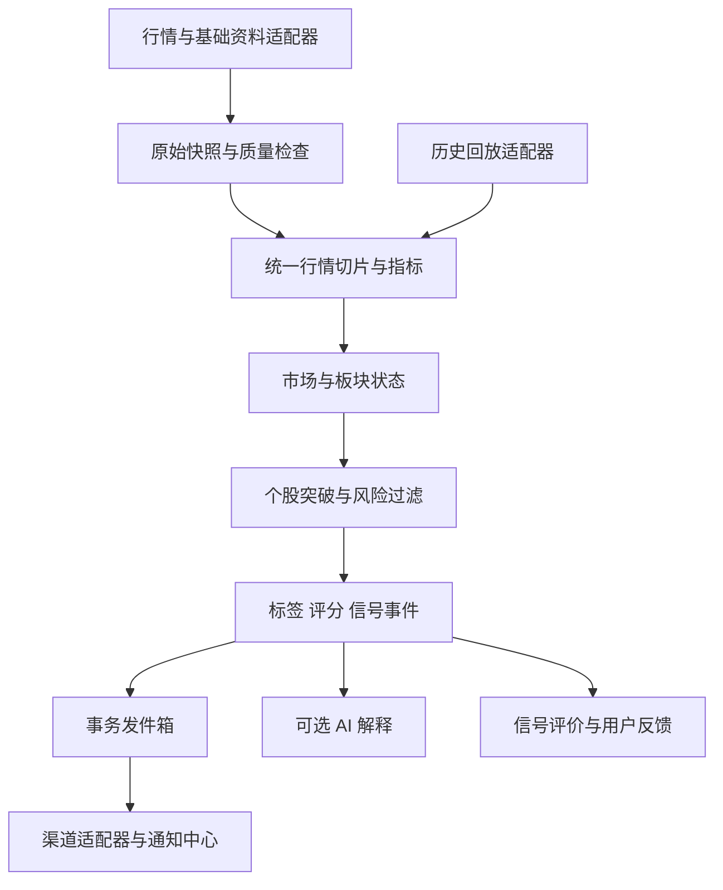

# 策略与工程规格

版本：v0.1｜2026-10-28｜关联：[产品需求](01-产品需求文档.md)。本文公式、架构和状态机属于 D 类设计；具体数值除用户的 10% 风险偏好外均为待验证配置。

当前实现为软件`0.2.0`离线增强版：Python3.9+标准库、原生ES modules/SVG、SQLite与JSONL，通知选择钉钉。下文的架构建议与完整验收仍是目标，实际模块/API/边界分别见[实现架构](../ARCHITECTURE.md)、[API参考](../development/api.md)和[交付验收](../development/acceptance.md)。

## 1. 系统结构

采用模块化单体＋独立后台进程。建议 Python 负责数据、策略和 API，TypeScript/React 负责轻量界面；事务状态用 SQLite，时序数据用 Parquet，研究查询可用 DuckDB。最终依赖版本经 PoC 锁定，不在本次文档中指定当前最新版。



MVP 不引入消息集群、图数据库、券商 SDK 或必需的多 Agent 框架。预留接口，不提前承担它们的运维成本。

### 模块边界

| 模块 | 输入 | 输出与职责 |
|---|---|---|
| universe | 标的、交易日历、证券状态、板块成分 | 时点有效股票池及排除原因 |
| providers | 供应商请求/原始响应 | 标准行情、能力声明、限流与质量报告 |
| features | 只在截止时刻可见的数据 | 确定性指标，不发送消息 |
| strategy | 指标、状态、冻结参数 | 评估结果与信号事件，不调用外部渠道 |
| persistence | 原始快照与业务事件 | 水位、版本、信号、发件箱、反馈 |
| notifier | 发件箱 | 渠道消息、失败和不确定结果 |
| replay | 历史事件序列、模拟时钟 | 同一策略输出、评价报告 |
| api/ui | 结构化查询与用户操作 | 鉴权、列表、详情、反馈和配置 |
| explain（可选） | 已保存的信号证据 | 解释文本；不改写指标和信号 |

## 2. 数据与时点纪律（FR01/02/12）

目标股票池为沪深主板＋创业板＋科创板，板块标识分别为 `MAIN`、`CHINEXT`、`STAR`；合法交易所/板块组合为 `SSE/MAIN`、`SZSE/MAIN`、`SZSE/CHINEXT`、`SSE/STAR`。`BSE` 仍不在目标范围。传输层接受 `STAR` 不等于策略已支持，配置资格、板块参数、覆盖分母、回放执行规则与页面范围说明须一起适配。交易规则按板块、交易所和生效日期分别核验，不能直接复用创业板规则或擅自放宽 10% 风险上限。

NEXT08已按上述范围完成离线工程和合成验收：新配置schema2显式提供STAR参数，使用新策略ID与配置哈希；历史v1配置/样例及全部策略输出保留原哈希，不自动切换或改写。真实科创板覆盖、历史与执行路径仍待独立PoC，见[NEXT08记录](../development/next08-star-acceptance.md)。

所有内部时间为 UTC，保留来源时区；交易日和页面行情时间按 `Asia/Shanghai`，与用户电脑时区无关。开闭市、午休、节假日、集合竞价来自版本化交易日历；首个策略基线仅在连续竞价的完成切片评估，其他时段只记录数据或做归档。

每条输入记录：`event_time`（市场事件）、`available_at`（系统最早可见）、`ingested_at`（实际接收）。策略截止 t 只能使用 `available_at <= t` 的记录，且指标的市场时间不能超过 t。历史数据没有真实可见时间时，使用声明的保守可见时间模型并标记模拟；不可伪称复现历史网络延迟。

基础能力包括：全市场批量行情/分钟线、历史日线、分钟成交累计曲线、标的状态、交易日历、复权因子、历史板块成员关系。数据源必须声明覆盖、粒度、最大批量、限流、时延、历史深度和授权边界。不能因 README 写了“实时/免费”就视为满足需求。

价格原始值用于通知与成交评价；跨除权的形态计算使用截至当时可知因子转换到一致基准。保存因子版本；禁止将当前后见复权序列无标记地用于历史可成交价。成交量单位归一为股，成交额为人民币元；明确增量和累计字段，重复消息不能重复累加。

乱序输入以事件键去重、按水位处理；迟到修正写新修订。已经投递的信号保留原快照，必要时发“数据修正”更新，不静默重写过去。断流期间状态为 UNKNOWN/暂停，不把缺数据当成市场退潮。

全市场覆盖低于配置门槛时，暂停本策略所有新机会推送；单板块覆盖不足时仅暂停其相关候选。恢复须完成新鲜度与覆盖复核。禁止为满足时延目标而绕过供应商限流；若全市场规模下能力不够，应更换数据方案或明确调整服务目标，不可静默缩成自选池。

## 3. 指标定义（FR03—FR07）

### 3.1 公共约定

- `U(t)`：时点合格股票集合；`B(t)`：板块有效成员；`V(t)`：其中具备新鲜且完整输入的成员。
- 停牌、被排除证券不进入可交易分母；合格但缺行情的股票仍在预期分母中，用于暴露缺失。
- `coverage = |V| / |B|`。广度在 V 上计算，必须同时显示 coverage；覆盖不足直接停止该板块新机会。
- 同板块每只证券只计一次。第一版板块收益采用有效成员等权平均，并披露中位数供诊断，不与供应商板块指数混用。
- `r_i(h,t)` 为相同口径价格在窗口 h 的收益；盘中相对昨日收盘使用已知除权调整参考价。基准指数由配置固定且同一时间窗可得。
- 除零、历史不足、无有效分母输出 null 和原因，不能置 0。

### 3.2 市场状态

使用基准的短长均线关系、基准历史波动、全市场上涨广度。分类顺序为：关键输入不足→UNKNOWN；波动超过高位阈值→HIGH_VOL；短均线高于长均线且广度通过上涨阈值→UP；反向且广度低于下跌阈值→DOWN；其余→RANGE。

均线和波动基于此前完成日线；广度使用当前切片。参数包含短长窗口、波动估计方法和阈值、上涨/下跌广度阈值。状态切换用连续有效切片确认；UNKNOWN 立即暂停新信号。

实验基线只在 UP/RANGE 允许启动突破，DOWN/HIGH_VOL 暂停新机会，但继续更新原信号与持仓风险。这是 D 类风险门槛，可以在隔离实验中比较替代方案；不得实时由 LLM 决定是否放宽。

### 3.3 板块启动特征

| 特征 | 定义 |
|---|---|
| 相对强度 RS | 板块等权收益 − 固定市场基准同窗收益 |
| 强度改善 ΔRS | 当前 RS − 前一个非重叠、等长度窗口 RS；跨午休按交易分钟计算 |
| 广度 breadth | V 中正收益股票数 / |V| |
| 突破广度 | V 中满足基础价格突破条件的股票数 / |V|；同时保留绝对数量 |
| 量能活跃度 RVOL | 同一成员集合当前截至同分钟累计成交额 / 过去 N 个合格交易日相同时点累计成交额的中位数 |
| 集中度 concentration | 当前板块成交额中，前 K 只股票占比 |
| 前期延伸 extension | 板块此前 H 个完整交易日累计收益，用于识别已上涨较久的阶段 |

RVOL 的分子分母必须来自同一可比成员子集，并报告历史可比覆盖率。不能只保留今天放量的股票进入历史分母。历史成分变更与缺口过大时拒绝计算。

`candidate_gate` 要求 RS、ΔRS、breadth、突破数量、RVOL 同时达到进入阈值，且覆盖、最小样本、集中度和前期延伸通过约束。不能以单项排名第一替代这些门槛。

### 3.4 个股突破

首个策略 ID：`hotspot_breakout_v1`。第一种可复现基线为“此前 N 个完整交易日整理区间突破”：

1. 盘前计算上边界 `H = max(high)`、下边界 `L = min(low)`，不含当日数据；`width = H/L - 1`。历史长度和区间宽度需通过门槛。
2. `ATR` 使用此前 M 个完整交易日的真实波幅简单平均；定义版本中明确不混用 Wilder 平滑。
3. 完成的一分钟收盘价 `P > H + breakout_buffer_atr × ATR`，且上一有效切片未满足此条件，形成突破事件；开盘首切片与调整后的昨收比较。
4. 个股同分钟 RVOL、相对板块强度 `r_i − r_B`、成交额/流动性通过门槛。
5. 追涨距离 `distance = (P − H)/ATR` 不超过上限；主板/创业板/科创板分组评估配置，不直接用统一涨幅排行。
6. 初始结构失效价 `S = H − invalidation_buffer_atr × ATR`；要求 `0 < S < P`，且 `(P − S)/P <= 0.10`。该价是实验规则，不等于保证止损成交价。
7. 同一触发 episode 的 H、ATR、S 冻结；后续日子若重算参考位，必须生成新版本或新 episode，不能移动失效位掩盖失败。

该定义是“整理区间”的首个可测试近似，不宣称覆盖全部技术形态。日内高点突破、人工画线和复杂形态识别延后。

初始可参与上界为 `min(H + max_distance_atr × ATR, S / 0.90)`；下界为突破确认价。若上界小于下界，则无可参与区间。实际价超界时标记偏离，不产生新的可参与提醒；从偏离恢复只更新原机会，不能当全新启动重复推送。

个股先突破、板块稍后进入候选时，允许在原 DETECTED 记录的有效期内重新评估；通知时重新检查价格、量能、分数与风险，不要求再次发生价格上穿。过期后不得用旧突破追认新机会。

### 3.5 标签契约

初始标签：`market.up/range/down/high_vol`、`sector.unusual/candidate/confirmed/fading`、`stock.breakout/volume_supported/relative_leader/overextended`、`risk.distance_exceeded`、`data.stale/incomplete`。

每条标签包含 `tag_id, definition_version, entity_type/id, value, observed_at, available_at, valid_until, evidence_ids, rule_version, status`。事实、计算结果与解释推断使用不同 `kind`；首版策略仅消费确定性计算及可核实基础字段。过期由定义驱动，不让旧标签永久加分。

轻量本体仅包含 Instrument、Sector/Theme、Membership、Observation、Tag、Signal、Evidence、Feedback，以及带时间的关系。先用关系表，不引入图数据库。

### 3.6 评分

仅对通过硬门槛且特征完整的候选评分。同策略同版本可比较，跨版本不能直接当成升降级。

`score = round(1 + 99 × Σ(w_j × f_j))`，`Σw_j = 1`，`f_j ∈ [0,1]`。

正向指标使用 `clip((x-a)/(b-a),0,1)`，负向指标使用其补值；所有 a/b 在训练阶段设定并写入版本，要求 b>a，禁止用未来全样本分布归一化。四个分组为市场匹配、板块质量、个股相对表现、入场位置；每组内特征与权重显式列入配置，不通过标签数量累计加分。

初始离线研究可使用 20%/30%/30%/20% 组权重作为对照，但不得称其最优。通知条件包括 `score >= alert_threshold`；门槛必须配置，不能默认沿用对话举例的 80 分。保存原始特征、归一化值、分项和最终分数；同分以触发时间、证券 ID 稳定排序。

## 4. 状态机与消息规则

### 板块状态

`NORMAL → UNUSUAL → CANDIDATE → CONFIRMED → FADING → NORMAL`。

- 任一启动维度越过异动阈值进入 UNUSUAL；全部 candidate_gate 连续通过 `candidate_slices` 次进入 CANDIDATE。
- 更严格的确认条件持续 `confirm_slices` 次进入 CONFIRMED；若同一切片已满足全部必要条件，可一步进入候选，保留原因。
- 未确认候选在 `candidate_timeout` 内未继续成立则回到 UNUSUAL/NORMAL。
- 已确认状态连续 `fade_slices` 低于退出阈值进入 FADING；退出阈值与进入阈值分离以减少抖动。
- FADING 后必须满足重置期和一次新的启动条件才能成为新 episode；数据中断不计入连续有效切片，恢复时重新积累连续性。

### 个股信号

`DETECTED → PREALERT → CONFIRMED → INVALIDATED / EXPIRED`；PREALERT 也可直接失效或过期。

- DETECTED 为内部记录。PREALERT 必须满足全部预警门槛、板块候选状态、分数门槛和当前可参与范围。
- CONFIRMED 为个股和板块确认条件均满足；不是通知已送达。
- 价格按失效规则跌破 S，或关联主板块持续退潮，标记 INVALIDATED。市场门槛变差先暂停参与、发条件变化更新；数据缺失只暂停，不能断言策略失败。
- 参与机会按 `entry_ttl` 过期后不可补发新机会，但已发信号继续保存后续评价；信号研究观察期与 entry_ttl 分开。
- `actionability = eligible / extended / paused / expired` 与信号状态独立。持仓生命周期也独立。
- 主板块在首次预警时冻结；保留所有关联，不能通过切换到另一个题材来避免退潮失效。

去重键：`strategy_version + instrument_id + trading_date + breakout_episode_id`。episode 持久化，由退出后重新满足重置条件生成，不使用进程启动时间或随机扫描 ID。跨日未结束的同一机会保留其首次交易日键，不能仅因换日重新发送。

热点聚合按成员 Jaccard 相似度阈值形成展示分组，保存分组版本；只合并通知，不抹去原板块指标。消息批次最多等待 `group_window_seconds`，合并只作用新机会，风险更新优先。

### 投递状态与可靠性

在同一数据库事务写 SignalEvent 和 Outbox。唯一键为 `signal_id + revision + channel`，状态为 pending/sending/accepted/failed/unknown/expired。

采用有上限的重试退避；发送前复查信号当前 revision、过期和数据质量。失效/过期的旧预警不得迟到发送，改为记录取消原因；相关更新的投递顺序按 revision 单调。

网络超时后可能服务端已接收，记 unknown。支持幂等键/回执查询的渠道先查询；不支持的渠道不能声称端到端 exactly-once，默认不盲重试 unknown，在内置中心显示并提示运行异常。明确失败的请求才按规则重试。

平台回调验签、校验时间戳并防重放；详情链接不携带可长期复用的明文凭据。个人微信与企业微信能力分别验证。

## 5. 核心数据契约

| 对象 | 最少字段 |
|---|---|
| Instrument | id、字符串代码、交易所、板块类型、上市/退市日期、状态有效区间 |
| Membership | instrument_id、sector_id、sector_type、valid_from/to、available_at、provider、snapshot_id |
| Quote/Bar | instrument_id、OHLC、volume_shares、amount_cny、interval、is_complete、event/available/ingested 时间、adjustment、source、quality、revision |
| FeatureSnapshot | entity_id、as_of、available_at、features、coverage、quality、input_snapshot_ids、feature_version |
| StrategyVersion | id、code_commit、配置内容/哈希、特征版本、市场规则版本、状态 draft/frozen/retired |
| Signal | id、episode_id、instrument_id、primary_sector_id、策略版本、触发价/时间、H/ATR/S、状态、actionability、score_parts、evidence_ids、expires_at、revision |
| SignalEvent | id、signal_id、前后状态、reason_codes、输入快照、时间、revision |
| Notification | id、event_id、channel、dedup_key、payload_hash、attempts、状态、平台回执、各阶段时间 |
| Feedback | id、signal_id、action、user_time、idempotency_key、关联成交记录 |
| TradeRecord（P1） | id、instrument_id、buy/sell、price、quantity、fees、trade_time、来源 manual、冲正关联 |
| EvaluationRun | id、版本/数据哈希、区间、基线、成本/延迟/退出模型、结果、缺口、随机种子（若使用） |

收益率统一为小数（0.10 表示 10%），分数为整数，未知为 null＋原因；价格/费用使用 Decimal 或最小单位整数。SignalEvent、TradeRecord 追加式保存，修正保留历史。数据保留时长和存储容量在 PoC 实测后配置；用于验证的冻结快照不得被自动清理。

## 6. 服务契约与 API

内部接口先定义类型和失败语义：

```text
MarketDataProvider.capabilities() -> ProviderCapabilities
MarketDataProvider.get_slice(as_of, universe) -> DataBatch + QualityReport
Strategy.evaluate(context, prior_state) -> EvaluationResult + StateEvents
Replay.run(dataset_id, strategy_version, start, end) -> EvaluationRun
Notifier.send(message, idempotency_key) -> accepted | failed | unknown
```

建议 HTTP API：

| 方法与路径 | 约束 |
|---|---|
| GET /api/v1/health | 来源健康、延迟、覆盖、水位，不暴露密钥 |
| GET /api/v1/market、/sectors | 返回 as_of、quality、状态和依据 |
| GET /api/v1/signals | 按状态/时间/板块分页，稳定游标 |
| GET /api/v1/signals/{id} | 触发快照、当前状态、时间线、通知结果 |
| POST /api/v1/signals/{id}/feedback | 幂等键必填，输入校验，不自动下单 |
| GET/POST /api/v1/strategy-versions | 新建版本；拒绝修改已冻结版本；未识别参数直接报错 |
| POST /api/v1/replays | 异步任务，返回 run_id；默认不允许外部投递 |
| GET /api/v1/replays/{id} | 进度、结果和明确的失败原因 |
| POST /api/v1/channels/{id}/test | 鉴权后显式测试，标记测试消息，不能自动向未知收件人发送 |

失败码至少包含 DATA_STALE、COVERAGE_LOW、HISTORY_INSUFFICIENT、CONFIG_INCOMPLETE、PROVIDER_LIMITED、NO_ACTIONABLE_RANGE、DELIVERY_UNKNOWN。前端展示可理解的中文，不用空列表掩盖任务失败。

## 7. 参数配置与默认策略

配置分三层：用户偏好、工程运行参数、策略实验参数。全部类型校验，未知键报错，单位写入 schema。

| 参数组 | 必需内容 | 初始状态 |
|---|---|---|
| 用户偏好 | 市场范围、`max_loss_fraction=0.10`、持仓复核周期 | 来自当前需求；10% 不自动成为组合仓位 |
| 运行模式 | fixture/replay/shadow/live_alert | 默认 fixture；切换需显式操作 |
| 调度 | slice_seconds、stale_after_seconds、收集超时、组消息窗口 | D：60 秒切片、90 秒过期阈值、5 秒合并窗口，须 PoC 验证 |
| 覆盖 | universe_min_coverage、sector_min_coverage、最小板块有效数量 | D：0.98/0.90；最小数量随策略配置 |
| 市场 | benchmark、短长均线窗口、波动窗口/阈值、广度阈值、状态持续次数 | E：必须通过实验配置提供 |
| 板块 | RS 窗口、ΔRS、广度/数量、RVOL、集中度、延伸阈值、确认/退出/重置次数 | E：不得存在隐藏默认值 |
| 个股 | N/M、区间宽度、突破缓冲、量能、相对强度、最小成交、追涨距离、失效缓冲 | E：按主板/创业板/科创板显式配置，缺失板块参数报错，不静默套用其他板块参数 |
| 评分 | 分项、归一化锚点、组内/组间权重、通知门槛 | E：组权重可从 20/30/30/20 对照起步 |
| 生命周期 | candidate_timeout、entry_ttl、重置期、每日新机会额度 | E：额度可关闭；风险更新不受额度限制 |
| 评价 | 延迟、滑点、费用、持有窗口、退出与缺价处理 | E：未配置不能声称成本后收益 |

研发可先提供小型合成数据对应的 `fixture` 完整参数配置，以稳定触发每种分支。随后为历史研究提供明确标记为 experimental 的完整配置；二者均不得自动成为 live_alert 配置。必需参数未决不阻碍实现接口与测试，但会阻止真实策略启用。

## 8. 历史评价与防偏差

1. 按时间划分研究/验证/冻结测试段，保存全部实验尝试；持有窗口跨分割边界的样本隔离，避免标签泄漏。
2. 使用当时股票池、板块成分和证券状态，覆盖退市与失效信号；无历史成分时明确只做前向验证，不能拿今日成分替代。
3. 信号生成不得使用未收盘的最终分钟高低价；从通知可到达时间＋用户反应延迟之后的下一可成交时点模拟入场，不能按触发价默认成交。
4. 最少比较 0/1/3/5 分钟额外反应延迟情景；0 分钟也必须在数据可见与计算之后。停牌、涨跌停/报价不可成交、价格超界按规则标记未成交，保留在覆盖和机会统计分母。
5. 费用、滑点、交易单位、可卖数量、当日买入后的卖出限制、不同板块规则均版本化并按历史日期应用。实现前核验适用交易所官方资料；不能让仿真在现实不允许卖出的时点成功退出。
6. 对同一分钟无法判断先后顺序的进出场条件使用保守顺序或更细数据，报告假设；价格跳空穿过止损位按下一可成交价评价，不把损失截断成 10%。
7. 固定持有窗口收益与“策略失效/风险边界/到期退出”两类报告分开；最终止盈与持仓退出策略未确认，不推导组合年化净值。
8. 输出 5/10/20 交易日收益、超额收益、最大有利/不利波动、到达后可参与率、未成交率、成本后均值/中位数、样本量、失败率与信号数。失败定义和分母固定；窗口未成熟标 pending。
9. 以交易日/热点聚类处理相关样本，不能将同一热点十只股票当十个独立证据。若给置信区间，记录方法；小样本只报告描述性结果。
10. 比较四组：个股突破单独、板块过滤＋个股突破、早期预警、确认后提醒。其余成本和执行假设保持一致。

评价中的“失败”需分开列示：结构失败为观察窗口内先触及冻结失效条件；收益失败为指定可成交持有窗口扣费收益小于 0；未成交不是盈利或亏损交易。三类各给出数量和分母，不混成一个含糊的成功率。未记录真实交易时，这些均为信号或仿真评价。

## 9. 开发任务与验收样例

| 阶段 | 交付任务 | 依赖与出口 |
|---|---|---|
| M0 契约与样例 | FR01/02/06/14：数据 schema、配置校验、模拟时钟、合成样例 | 无真实密钥可运行；全部数据注明模拟 |
| M1 数据 PoC | 评估批量行情、分钟历史、成分历史、口径、限流、费用与常驻网络 | 至少一个数据路径实测；缺项如实列出；不得跳过历史覆盖问题 |
| M2 策略闭环 | FR03—08/12：特征、状态机、评分、过滤、回放 | 相同输入重放一致；提供完整 experimental 配置和边界测试 |
| M3 通知与页面 | FR09—11/13：事务发件箱、通知中心、一个渠道、详情与反馈 | 断源、重复、超时、迟到和重启行为通过；真实渠道需已配置收件人 |
| M4 研究与影子 | 样本外对照报告、全市场负载、连续运行、恢复与备份 | 满足产品文档发布门槛；策略效果不足时保留研究状态 |
| M5 可选增强 | FR15/16：持仓提醒、AI 解释、第二渠道 | 不阻塞 P0；独立验收 |

| 测试 ID | Given / When | Then |
|---|---|---|
| AT01 | 相同冻结输入回放两次 | 指标、分数、状态与事件序列一致 |
| AT02 | 只有单只权重股拉升，广度不足 | 可记录异动，不发启动机会 |
| AT03 | 板块候选＋个股突破＋风险过滤＋分数均满足 | 只创建一个预警；无需等待最终确认 |
| AT04 | 总分很高但结构失效距离 >10% | 拒绝可参与提醒并记录原因 |
| AT05 | 切片缺失/过期/覆盖不足 | 相关新机会停止；已有状态显示暂停，非失效 |
| AT06 | 同股三个相似题材同时触发 | 一个股票机会，保留关联证据，不累计三次分数 |
| AT07 | 重复数据、跨日重启、发件箱重放 | 无重复业务信号；未知外部投递按 unknown 处理 |
| AT08 | 通知排队期间价格超界或信号失效 | 旧预警不迟到发送，记录过滤原因 |
| AT09 | 断流后恢复、迟到修正 | 重建连续性；保留旧快照，修订可追溯 |
| AT10 | 除权、涨跌停、停牌、日内不可卖或跳空 | 不制造假突破/不现实成交；损失可超 10% |
| AT11 | 新股历史不足、分母为 0、单位不一致 | 返回明确不可算原因；不补造得分 |
| AT12 | LLM 超时或输出伪造数字 | 模板通知正常；伪造文本不进入数值与状态 |
| AT13 | 用户反馈重复提交或未记录买入 | 不重复成交记录；不生成假持仓浮亏 |
| AT14 | 修改策略参数、使用未知键 | 新版本并校验；旧信号保持旧版本 |
| AT15 | 午休、节假日、跨时区主机 | 依交易日历运行；不把非交易时间算连续确认分钟 |
| AT16 | 后续日期信息或当前板块成员试图进入历史回放 | 拒绝或标记数据集不具备时点有效性 |
| AT17 | 科创板合格/不合格证券、缺失 STAR 参数、错误交易所组合、科创板行情缺失及新旧版本回放 | 合格证券纳入股票池和覆盖分母；不合格对象保留过滤原因；缺参数/错误组合报错；缺行情降低覆盖并按门槛暂停；10% 硬门槛与版本不变性保持；科创板执行规则单独验证 |

每个阶段输出运行命令、脱敏配置、版本清单、验证结果与剩余风险。不可用截图替代数据正确性与恢复测试，不把 README 的性能声明当成本项目验收结果。
