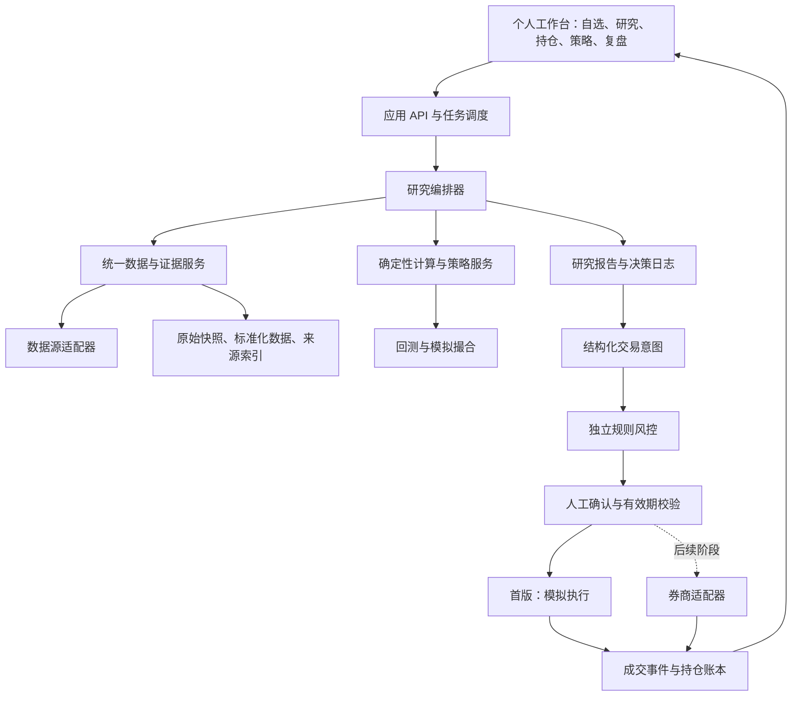

# 个人投资交易智能体 · 初步开发蓝图

> 历史提案：首版产品范围与开发顺序已由[当前需求与工程规格](../../docs/requirements/README.md)替代。保留本文供追溯，不据此启动日线投研或券商执行开发。

状态：研发提案，尚未开始产品实现。依据为 [19 项目档案](01-项目选型总览.md) 的文档级调研；下述架构与验收标准是我们的设计，不是上游能力保证。

## 1. 产品目标与暂定范围

软件需要围绕一个人的真实工作流：维护自选与持仓，理解行情和公司变化，生成可追溯研究，检验策略，记录决定，比较预期与实际结果。聊天是入口之一，研究产物、持仓账本和决策记录才是长期资产。

为让第一版可落地，暂定：单用户、本地优先、A 股日线研究优先，预留美股和港股；先导入持仓流水，再接只读账户；先做纸面模拟，再接实盘。这是可调整的工程假设，不代表用户已经选择了市场、券商或交易风格。

首版包含：自选列表、个股研究、盘后简报、持仓账本、确定性规则筛选、带费用假设的回测、模拟订单与复盘。高频交易、杠杆衍生品、多用户服务、全市场实时扫描和模型自动调参暂列后续。

## 2. 五个核心使用流程

| 流程 | 用户输入 | 系统产物 | 必须可检查的内容 |
|---|---|---|---|
| 个股研究 | 标的、研究问题、截止时间 | 基本面、技术面、事件和反方观点 | 每个关键事实的来源与时间；缺失字段；推断与事实区分 |
| 盘后简报 | 自选列表、关注规则 | 异动、公告摘要、策略触发与待办 | 数据是否完成更新；简报是否重复；失败重试记录 |
| 持仓复盘 | CSV 流水或手动记账 | 仓位、成本、已实现/未实现损益、集中度 | 币种、费用、分红拆股、重复交易、现金余额 |
| 策略验证 | 参数、股票池、区间、成本模型 | 信号、回测交易、净值、风险与基线对比 | 信号可见时间、成交假设、被拒订单、样本外结果 |
| 模拟交易 | 用户采纳的交易意图 | 模拟委托、成交、账本变更、复盘 | 风控判定、幂等键、成交依据和账本对账 |

研究结果允许“信息不足，无法判断”。不将多个 LLM 角色的投票数包装成校准后的概率，也不把预测价格直接转成自动订单。

## 3. 架构边界

建议先做模块化单体：一个应用 API、独立后台任务进程和本地存储。LLM、数据端点、回测引擎和券商通过接口替换；Qlib、Kronos、vnpy 或 NautilusTrader 若引入，放在独立运行环境中，避免 Python、GPU 或二进制依赖相互污染。

初步技术方案为 Python 业务/计算层 + React/TypeScript 工作台；事务账本用 SQLite，时序研究数据用 Parquet 并按需通过 DuckDB 查询。是否选 FastAPI、哪套 UI 底座以及是否直接接入某个上游模块，要以 PoC 结果确定。单用户首版暂不引入 Redis、MongoDB、消息集群等非必要组件。

## 4. 上游项目如何进入架构

| 模块 | 第一轮参考 | 接入方式与边界 |
|---|---|---|
| 投研工作区 | Vibe-Research | 借鉴研究流程、持仓导入和研究记录；先验证本地运行 |
| 数据服务 | a-stock-data、daily_stock_analysis | 选少量端点，抽成类型化适配器；统一时间、单位与错误语义 |
| 分析编排 | TradingAgents | 验证角色分工、结构化输出、断点恢复；工具白名单与调用预算由本产品控制 |
| 策略与回测 | tick-stock-panel、Sequoia-X | 先研究契约与规则；Sequoia-X 的直接代码复用须先补足许可确认 |
| 报告方法 | UZI-Skill、WyckoffTradingAgent | 少量可解释维度与形态证据；分别处理许可，不批量植入所有角色 |
| 定时任务 | daily_stock_analysis | 参考调度、数据降级、通知；保存自己的任务状态和去重键 |
| 执行候选 | vnpy、NautilusTrader、Vibe-Trading | 第二阶段以目标券商与操作系统为硬条件进行模拟验证 |
| 高级研究 | Qlib、Kronos | 后期离线实验，独立数据快照、模型版本和样本外评测 |
| 界面与资料 | OpenStock、jcp、ai-financial-agent、awesome-quant、美股指南、TradingAgents-CN | 参考产品与资料结构；应用层代码、外部库、背景知识分别复核 |

19 个项目的价值不同。最终产品可能只直接依赖其中少量项目，其他项目用于设计参考或替代方案。不要先假定必须 fork 一套完整平台。

## 5. 核心数据契约

| 对象 | 最少字段 | 关键约束 |
|---|---|---|
| Instrument | 内部 ID、交易所、原代码、资产类型、币种、时区、日历、价格/数量精度 | 股票代码保存为字符串，不能丢失前导零；相同代码跨市场不可混同 |
| Observation | instrument_id、event_time、available_at、fetched_at、provider、字段、值、单位、quality | 财报期末时间不能替代公开发布时间；缺失值不能填成 0 |
| Bar | OHLCV、频率、开始/结束时间、复权模式、原始来源、快照 ID | 研究价与可成交价格分开；不同复权源不能静默拼接 |
| Evidence | 来源 URL、文档 ID、内容哈希、发布时间、取数时间、引用位置 | 报告可回溯到证据；二手摘要不得冒充公告原文 |
| ResearchRun | run_id、截止时间、数据快照、模型/提示词/策略版本、成本、状态 | 同一输入可重放计算；LLM 输出允许有变化，但保留原始响应 |
| Signal | 标的、策略版本、参数、as_of、触发依据、有效期 | 研究信号不等于成交指令；参数和训练区间必须留档 |
| OrderIntent | intent_id、账户、标的、方向、数量、订单类型、限价、理由、来源 run_id | LLM 只能提出意图，不能直接拿券商凭据下单 |
| RiskDecision | 意图哈希、规则版本、allow/reject、理由、检查时点、限额快照 | 规则决策可重复验证，失败默认阻止执行 |
| Order / Fill | client_order_id、broker_order_id、状态、数量、价格、费用、事件时间 | 超时不等于失败；未知状态先查询，不重复发送 |
| LedgerEvent | 事件 ID、成交/转账/费用/分红类型、金额/数量、币种、关联对象 | 追加事件并支持冲正，禁止静默覆盖历史流水 |

所有时间内部保存 UTC 与来源时区，界面按市场时区显示。保存交易日历版本；跨市场业绩统一估值币种时记录汇率来源和时点。

## 6. 数据质量与研究可信度

对首版必需的行情、财务和公告分别设置新鲜度阈值，阈值由数据频率决定。过期数据可用于带标记的历史研究，不能用于声称“当前可交易”的执行判断。

适配器必须返回 `ok / partial / stale / unavailable`，并记录来源、重试和降级路径。出现字段缺失、单位冲突或复权未知时，报告明确显示问题，不由 LLM 补数。主备源切换需保留来源标记，不拼接出看似连续但口径不同的序列。

公告、新闻与检索文本视作不可信数据，只进入研究上下文，不能改变工具权限或系统指令。估值、损益、仓位、收益率等数值由确定性代码计算；LLM 负责解释和提出待检验假设。

## 7. 回测与模拟执行

策略输入需具有 point-in-time 语义，财务数据按公开时间可见；股票池要记录历史成分和退市情况，避免只对今天存活的股票回测。按时间划分训练、验证、测试区间，冻结最终测试集，记录所有调参尝试。

首版日线研究使用明确的下一可交易时点成交模型，不假设收盘后产生的信号能按当天收盘价成交。交易费用、滑点、涨跌停/停牌、最小交易单位、可卖数量和结算约束按市场规则配置；具体规则上线前从目标市场与券商官方资料重新核验。

指标至少包括净值曲线、最大回撤、年化收益、波动、换手、交易次数、成本占比及基线比较；样本太短或交易太少时标记统计不稳定。模型预测误差改善不等于交易收益改善。

模拟撮合必须保存无法成交、部分成交和撤单记录。纸面账与真实账分开，模拟价格不标为真实成交价。

## 8. 交易执行与运行保障

未来执行服务采用 `draft → risk_checked → confirmed → submitted → partial/filled/canceled/rejected/unknown` 状态机。人工确认绑定意图哈希和有效期；数量、价格或账户变化后重新校验。执行前重查行情、资金、仓位和风控。

风控由代码实现：单笔与总敞口限额、集中度、允许交易标的、最大挂单数、行情新鲜度、资金与可卖数量、日内损失阈值和紧急停止。阈值由用户明确设定，本文不虚构风险偏好。

调用超时或重启后，按幂等键查询并对账，不盲目重下单。紧急停止至少阻止新单并尝试撤单，撤单失败可见；是否平仓另行定义，不能把紧急停止等同于必然卖出全部资产。

密钥存储在系统钥匙串或受控 secret 存储；日志、模型上下文和研究资料库不包含券商密钥。研究和执行权限分离；模型生成代码只能在无交易凭据的受限环境中验证。

## 9. 成本与交付标准

目前不估算具体订阅价格或月费。PoC 应记录模型 input/output tokens、缓存命中、每次研究调用数、数据服务档位、存储增长和硬件需求。日预算耗尽时暂停新增昂贵任务，保留可查看的旧产物。

首版完成的定义：用户能导入自选与持仓，生成带来源的个股报告，查看盘后简报，对至少一个规则策略做可重现回测并进行模拟记账，重启后研究和账本不丢失。所有外部失败均可见，核心计算和账本可独立于 LLM 校验。
